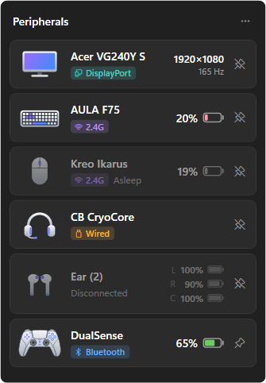
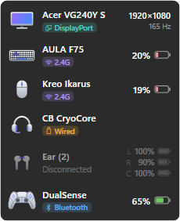
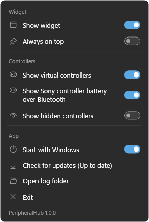

# PeripheralHub

[](https://github.com/hemanthvj12/peripheral-hub/actions/workflows/build.yml)

One data layer for all your peripherals: battery level, whether each device is reachable, and how it is connected (cable, 2.4G receiver or Bluetooth), updated live. It talks to the devices directly, so no vendor software needs to run.

<p align="center">
  
  &nbsp;
  
  &nbsp;
  
</p>
<p align="center"><sub>The tray panel, the desktop widget and the menu</sub></p>

| Device | Cable | 2.4G receiver | Bluetooth |
|---|---|---|---|
| Kreo Ikarus | battery %, charging | battery %, charging, online/asleep/offline | battery % (from Windows), no charging state |
| AULA F75 | charging, last level as "was N%" | battery %, charging (level hidden while charging), online/asleep/offline | battery % (from Windows), no charging state |
| DualSense / Edge | battery %, charging | n/a | battery %, charging |
| DualShock 4 | battery %, charging | battery % via Sony adapter (untested) | battery %, charging |
| Virtual DualSense / DualShock 4 (made by apps like punktfunk) | hidden unless "Show virtual controllers" is switched on in the menu; then shown with a grey badge naming the app (e.g. "☁ Virtual (Punktfunk)"), no battery (these apps report a made-up level) and no pin | | |
| Xbox controllers (untested with a real one) | no battery (Xbox controllers don't report it on a cable) | battery as Empty / Low / Medium / Full via the Xbox Wireless Adapter, no charging state | battery % from Windows when there's one, else Empty / Low / Medium / Full; no charging state |
| Virtual Xbox 360 controller (DSX's Xbox mode, verified) | same tray setting; then a grey "☁ Virtual (Nefarius)" badge, no battery | | |
| Nothing earbuds (Ear (2), verified) | n/a | n/a | left, right and case %, charging per part (over Nothing's own channel, about once a minute); Windows' level until the first reading; Ear (2): click the tile to open a drawer with noise control and "Open Abyss X" (noise cancelling with High / Mid / Low / Adaptive, transparency, off), greyed while Abyss X is open |
| Monitors (Acer VG240Y S on DisplayPort, verified) | name, video connection badge (DisplayPort, HDMI, USB-C, DVI, VGA, Built-in, Wireless; teal), resolution and refresh rate; click the tile for brightness and speaker-volume sliders over DDC/CI, and click the speaker icon to mute (only for monitors that answer DDC/CI; only brightness, volume and mute are ever read or written) | n/a | n/a |
| USB headsets, any maker (CB CryoCore, verified) | shown while plugged in (a USB device with both speakers and a mic in Windows; a controller's headphone jack doesn't count), "Wired" badge, no battery; click the tile for "Set as default", which makes it Windows' sound output and mic | n/a | n/a |
| Other Bluetooth earphones, headsets, mice, keyboards, gamepads | n/a | n/a | battery % (from Windows), no charging state; appears once connected, then stays (Disconnected) until the app restarts |

**Adding a device:** there's no in-app tool for it. Clone the repo, connect the device, install its maker's app, and ask an agent (Claude Code) to add it: the `add-device` skill in `.claude/skills` walks through finding the protocol, probing the device safely, writing the plugin and testing it.

## Projects

- `src/PeripheralHub.App`: the tray app (WPF). It runs the library in-process.
- `src/PeripheralHub.Core`: the library (.NET 8, Windows): `DeviceHub`, the plugin loader and the generic Bluetooth driver.
- `src/PeripheralHub.Sdk`: what plugins build against: `DeviceSnapshot`, `IDeviceDriver`, `IDevicePlugin`, the plugin manifest, HID/Bluetooth access and the shared receiver-driver plumbing.
- `plugins/`: the built-in device plugins: `kreo-ikarus`, `aula-f75`, `sony-controllers`, `nothing-ear` and `xbox-controllers` (see "Plugins").
- `.claude/skills/add-device`: instructions and a probe template for an agent adding a new device.
- `tests/PeripheralHub.Tests`: unit tests built from frames captured from the real devices.

## Install

Run **`PeripheralHub-win-Setup.exe`**. It installs for the current user without admin rights, to `%LOCALAPPDATA%\PeripheralHub`. It adds a Start-menu shortcut and an entry in **Settings → Apps**, then starts the app. If the PC lacks the .NET 8 Desktop Runtime, Setup installs it first (that one step asks for admin). The installer isn't code-signed yet, so a downloaded copy may show Windows' "Windows protected your PC" screen; use **More info → Run anyway**.

**Uninstall** from Settings → Apps → PeripheralHub. It closes the app and removes its files, shortcut and *Start with Windows* entry (if it points at this copy). Settings in `%APPDATA%\PeripheralHub` are kept, so a reinstall picks up pinned devices and the widget position.

**Updates:** the app checks GitHub Releases at startup and once a day, downloads a new version in the background and installs it the next time it starts; the menu shows *Restart to update* to install it straight away, or *Check for updates*. Running a newer `PeripheralHub-win-Setup.exe` also upgrades the installed copy in place and keeps your settings.

**Log:** the tray menu's *Open log folder* opens `%APPDATA%\PeripheralHub\logs`. `peripheralhub.log` records startup, plugins turning on, update checks and crashes. It is kept to about 2 MB. The tray menu also shows the running version.

### Releasing

Push a version tag and GitHub does the rest (`.github/workflows/release.yml`): it checks the tag is on `main`, builds, runs the tests and publishes the release with Setup and the update packages. Installed copies update to it at their next check.

```powershell
git tag v1.2.3
git push origin v1.2.3
```

Each release needs a higher version than the last. *Run workflow* on the Release workflow's page in the Actions tab is a trial run: it builds the installer for a version you type and keeps it as a download, without publishing.

### Building the installer locally

```powershell
./build-installer.ps1 -Version 1.1.0            # artifacts\installer\PeripheralHub-win-Setup.exe + update packages
./build-installer.ps1 -Version 1.1.0 -Publish   # also uploads them as GitHub release v1.1.0 (uses gh's login; normally the tag does this)
```

It publishes the app and packs it with [Velopack](https://velopack.io) (`vpk`, pinned in `.config/dotnet-tools.json`; `dotnet tool restore` fetches it). Each release needs a higher version than the last.

### Development install

```powershell
./install.ps1
```

This is for development: it builds and installs a separate copy to `%LOCALAPPDATA%\Programs\PeripheralHub`, without Settings → Apps or updates. Don't keep it alongside the Setup-installed copy, since only one copy can run at a time. `./install.ps1 -Uninstall` removes it.

**Testing an install from Claude Code's desktop app:** commands started there run inside the Claude app's sandbox. Windows redirects whatever they install into Claude's private storage, and elevated processes can't see it, so Allow fails with "cannot find the path". Run Setup from File Explorer to test it for real.

## Tray app

```bash
dotnet run --project src/PeripheralHub.App
```

- **Tray icon:** a purple-to-blue badge with a gamepad and a mouse, drawn by `IconFactory` (also used as the .exe icon). Hover to see every device's battery. Left-click opens the panel. Right-click (or ⋯ in the panel) opens the app menu: switches for *Show widget*, *Always on top*, *Show virtual controllers*, *Show Sony controller battery over Bluetooth* (on by default, shown only while a Sony controller is paired over Bluetooth; see Known limitations), *Show hidden controllers* (when HidHide is installed) and *Start with Windows*, plus *Get new versions…*, *Open log folder* and *Exit*; the version is at the bottom.
- **Panel:** one tile per device, showing the product picture, battery % with an Android-style battery icon (green at 50% or more or when charging, amber at 21–49%, red at 20% or less, grey when not online, bolt while charging), a coloured connection badge (Bluetooth blue, 2.4G purple, Wired amber, a monitor's video link teal) and state (*Asleep*, *Offline*, *Disconnected*). Charging and full are shown by the bolt, not words; only a charging error is spelled out. The Kreo level is calculated from the voltage the same way the Kreo app does it, so the two agree within about 1%; small upward wobbles while it isn't charging are ignored. Clicking a Kreo, AULA, Ear (2) or monitor tile opens a drawer under it with "Open <maker's app>" (noise control for the Ear (2); brightness and volume sliders for a monitor, which also move with the mouse wheel); in the widget a click opens it too, while a drag still moves the widget. Devices that aren't online are dimmed and show their last known battery. Controllers and other Bluetooth devices (earphones, headsets, mice, keyboards, gamepads; the latter with a generic icon once they report a battery level to Windows) appear when they connect and disappear as soon as they disconnect, unless pinned (see "Pin = keep"). A mouse or keyboard that is Asleep or Offline behind its plugged-in receiver stays. The panel closes when you click elsewhere or press Esc.
- **Pin = keep:** the pin button on a panel tile keeps that device on the list even while it's disconnected, and after the app restarts: it shows greyed as *Disconnected* with its picture and last levels (left/right/case for earbuds), in its usual place by type (monitors, keyboards, mice, audio, controllers). Unpinned devices leave the list as soon as they disconnect. Unpairing ("Remove device") a Bluetooth device in Windows removes it from the list and unpins it (after two scans, about 4 seconds, so a Windows hiccup can't wipe pins).
- **Widget:** shows the same devices as the panel, in compact tiles. By default it lives on the desktop, below all windows, and stays visible after Show desktop (Win+D): it is owned by the desktop window and kept at the bottom of the z-order. *Always on top* (tray menu or right-click on the widget) makes it a topmost window instead. Drag it to move it; right-click it to hide it.
- **Device pictures:** the app draws every device itself in one style: silver with purple-to-blue details, the same in light and dark themes. Controllers have their own model's picture (DualSense, DualSense Edge, DualShock 4, Xbox), built from the CC0 Gamepad Line Art Pack by gidedin and filled in silver; other devices get one per type (monitor, keyboard, mouse, headset or earbuds). Sources are `src/PeripheralHub.App/GenericPictures.xaml` and `src/PeripheralHub.App/Art` (see its README); `PeripheralHub.exe --write-art <file.png>` renders them all for a quick look.
- **Settings:** stored in `%APPDATA%\PeripheralHub\settings.json` (kept/pinned devices with their name, type, picture and last levels, widget position, widget on top, and the last battery level of each device, shown greyed out after a restart until a fresh reading arrives). *Start with Windows* uses the per-user Run key; Setup turns it on once, at the first start after installing.
- **Launching again:** starting the app while it's already running opens its panel. `--open` opens the panel on startup.
- **Theme:** follows Windows' light/dark mode and accent colour.

## Using the library

```csharp
using var hub = new DeviceHub();
hub.DevicesChanged += (_, e) =>
{
    foreach (var d in e.Devices)
        Console.WriteLine($"{d.Name}: {d.Connection} {d.State} {d.BatteryPercent}% {d.Charging}");
};
hub.Start();
```

Each `DeviceSnapshot` has `Id`, `Name`, `Kind`, `Connection` (`None/Wired/Dongle/Bluetooth/Virtual`), `State` (`Online/Asleep/Offline/Disconnected`), `BatteryPercent` (null when no trustworthy value exists; the last known value when not online), `Charging` (`Unknown/Discharging/Charging/Full/Error`), `BatteryUpdatedAt`, `LastSeenAt`, `VoltageMillivolts` (Kreo only), `Note`, `Paused` (the maker's app is open, see below) and `Model` (`kreo-ikarus`, `aula-f75`, `dualsense`, `dualsense-edge`, `dualshock4`, `xbox`; null for other Bluetooth devices, whose `Id` is `bt:<mac>` and `Kind` may be `Audio`).

### Device states

| State | Meaning |
|---|---|
| `Online` | Reachable now. |
| `Asleep` | Its 2.4G receiver is plugged in but the device is not answering. Usually it is asleep and wakes when touched (the app notices within about a second), but it may also be switched off or moved to another mode: the receiver cannot tell these apart, it only sees the link drop. |
| `Offline` | Asleep for longer than `PeripheralHubOptions.OfflineAfter` (default 10 minutes), so most likely switched off. Measured sleep times: the Kreo sleeps about 60 s after the last movement, the F75 after about 5 minutes idle. |
| `Disconnected` | Its receiver is unplugged, its cable is out, or it is paired over Bluetooth but not connected. |

## Working alongside other apps

- **Vendor apps (Kreo, AULA).** They use the same command channel as this app. While one of them is running, PeripheralHub stops sending requests to that device and only updates from replies it overhears, including the receivers' own status messages (the tile's tooltip says it's paused). It resumes as soon as the vendor app closes. Bluetooth readings come from Windows, so they keep updating.
- **HidHide (installed with DS4Windows/DSX).** It hides controllers from apps so that games only see a virtual one (DSX turns hiding on whenever it runs, even in native mode). A hidden controller isn't visible to PeripheralHub, so its tile disappears, or shows as Disconnected if pinned. To see it anyway, tick **Show hidden controllers** in the tray menu (shown when HidHide is installed): Windows asks for admin rights once, and PeripheralHub is added to HidHide's allowed apps. Untick it to remove it again. Reinstalling HidHide clears its list, so tick it again afterwards; uninstalling PeripheralHub removes its entry.

## Plugins

Devices that need their maker's protocol (anything on a cable or 2.4G receiver, and the PlayStation controllers) are supported by plugins. Without plugins, the hub still shows any Bluetooth device that reports a battery level to Windows. The Kreo and F75 also show up that way over Bluetooth: level only, no charging state, no product picture.

A plugin is a folder holding `plugin.json` and its assembly (no pictures: the app draws every device itself). The hub reads the manifests in:

- `plugins\` next to the exe (the built-in ones, replaced on each install), and
- `%APPDATA%\PeripheralHub\plugins` (for plugins added later; when an id is in both, the higher `version` wins).

**Plugins turn on automatically when their device is detected.** Until then they are dormant: only the manifest is read, and none of the plugin's code is loaded. A device counts as detected when one of the manifest's `usb` IDs is plugged in (cable or receiver), or one of its `bluetooth` IDs is connected (paired but switched off doesn't count). The plugin then starts within one scan (about 2 s). It is remembered in `%APPDATA%\PeripheralHub\activated-plugins.json`, so it is on from startup next time, even if the device is asleep or unplugged. `DeviceHub.Plugins` lists what's `Available` and `Active`; `DeviceHub.PluginActivated` fires when one turns on.

A folder that can't be used (bad manifest, needs a newer plugin API) is skipped, and so is a plugin that fails to start (e.g. its dll is missing; it's tried again after a restart). The rest still work, and `DeviceHub.Plugins.Errors` says what went wrong.

`plugin.json` (see the built-in ones in `plugins/*/plugin.json`):

| Field | Meaning |
|---|---|
| `id`, `name`, `version` | Lower-case id, display name, `major.minor.patch` |
| `sdkVersion` | Plugin API version it was built for (currently 2; 2 added monitors and sound devices) |
| `assembly` | The dll, relative to the folder. It must have exactly one public class implementing `IDevicePlugin` |
| `devices` | IDs it handles: `connection` (`usb` or `bluetooth`), hex `vendorId`, optional `productId` (omitted = every product of that vendor) and `manufacturer`. Bluetooth entries keep the generic Bluetooth driver away from those devices |
| `alwaysOn` | `true` turns the plugin on at every start without detection, for devices the scan can't see (Xbox controllers via XInput, monitors) |
| `vendorApps` | The maker's app per model: `displayName`, `installedName` (start of its installed-programs name), `exePaths`, `processName`, `defaultInstallFolder`. While it runs, receiver drivers pause, and clicking the panel tile opens it |

To write one, make a project in `plugins/` with a `PluginId` property (the shared `plugins/Directory.Build.props/.targets` reference the SDK without copying it and stage the folder in `artifacts/plugins`). Implement `IDevicePlugin.CreateDrivers` to return your `IDeviceDriver`s. For a mouse or keyboard with its own receiver, derive from `ReceiverDeviceDriver<TSession>`, which handles the cable/receiver/Bluetooth priority, the asleep/offline/disconnected states and pausing while the maker's app is open. Projects in `plugins/` are shipped with the app automatically.

## Known limitations

- **F75: no true level while charging.** The keyboard estimates its level from battery voltage, and charging pushes the voltage up, so while it charges its number is too high. There's no way to tell from its reply (just level + power flag). Tested 2026-10-29:

  | Scenario | What the keyboard reports | What the tile shows |
  |---|---|---|
  | Dongle, on battery | Real level | The level |
  | Bluetooth, on battery | Real level, no charging info | The level |
  | Wired (cable to the PC) | No level at all (it switches itself to wired mode) | Charging bolt + greyed "was N%" |
  | Dongle + charger, keyboard's own cable | Charging flag; level climbs far too fast (87 → 93 in under 2 min) | Charging bolt + greyed "was N%" |
  | Dongle + charger, other cable | No charging flag (power-only cable, or not charging) | Whatever level it sends |
  | Bluetooth + charger | No charging flag; level climbs too fast | That inflated level, as if live |
  | Just unplugged from a charger | Starts too high, drifts down to the real level over a few minutes (off and on fixes it at once) | That level, as if live |

  Limitations: "was N%" is the last level before charging started, so if the charger goes back in while the reading is still settling, "was N%" is inflated too (by how much depends on how long it charged; about 7% after a 3-minute charge). The app can tell when the cable was just pulled, but not when the reading is accurate again, so it shows what the keyboard sends. The Kreo, by contrast, reports a real level on its cable.
- **Bluetooth charging state.** The standard Battery Service has no charging flag, so mice and keyboards on Bluetooth show `Charging: Unknown`. The same goes for other Bluetooth devices (earphones report their level through the hands-free profile, which has no charging flag either). Earphones with a separate level per bud or for the case only show the one level Windows gets.
- **PlayStation controllers on Bluetooth: battery vs. input in some apps.** Over Bluetooth a DualSense, DualSense Edge or DualShock 4 only sends its battery in "full" mode, which an app has to switch on, and it stays on until the controller is turned off and on. Steam, DSX and games with PlayStation controller support work in full mode; browsers (e.g. gamepad tester sites) and older plain-gamepad games stop seeing its input. The menu switch *Show Sony controller battery over Bluetooth* picks how PeripheralHub handles this (it's only shown while a Sony controller is paired over Bluetooth). On (default), it switches controllers to full mode so the battery always shows. Off, it leaves them in basic mode: the battery then shows only while Steam, DSX or a game has switched full mode on; otherwise the tile shows the last level, greyed ("was 82%"), or "Basic mode" when it has none. After turning it off, turn the controller off and on once; the switch's tooltip reminds you until you do. Cable, Sony adapter and virtual controllers are not affected.
- **Shared USB ID.** On its cable the F75 uses the generic Sinowealth ID `258A:010C` and calls itself just "Gaming Keyboard". The app also requires the manufacturer "BY Tech" (AULA's keyboard maker), so other keyboards with that chip aren't mistaken for it. Another BY Tech-built keyboard with the same ID still would be.

## License

[MIT](LICENSE). The controller drawings in `src/PeripheralHub.App/Art` are from the CC0 Gamepad Line Art Pack by gidedin (see `Art/README.md`). Product names such as DualSense, Xbox, Kreo, AULA and Nothing are trademarks of their owners; PeripheralHub is not affiliated with or endorsed by them.
